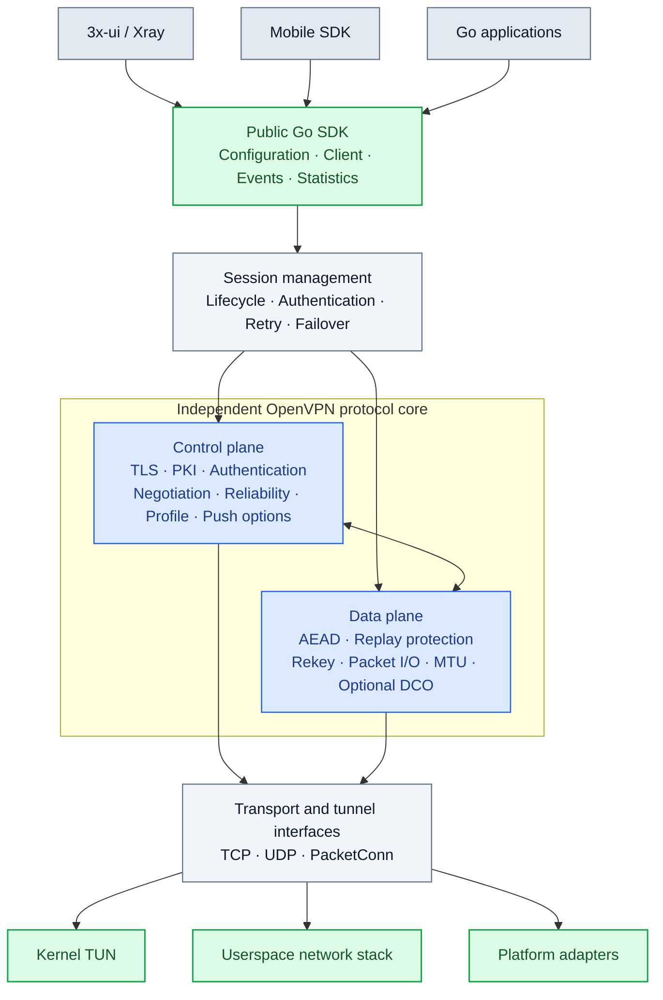

# OpenVPN Go

An independent, modular Go implementation of the OpenVPN client protocol.

> **Status:** M6 engineering checks and the M7 Xray adapter passed. The beta candidate awaits independent review and release approval.

## Project intent

Build a new implementation from public protocol documentation and independently written requirements. The project is not a continuation of the MPL-2.0 codebase in the legacy go-openvpn repository.

Applications can embed the OpenVPN client engine. The Linux 3x-ui/Xray
adapter attaches a host TUN through the public client API.
[Integration guide](integrations/xray/README.md)

## Design principles

- Protocol correctness and interoperability before feature breadth.
- Strict certificate-chain and server-identity verification by default.
- Small public API; implementation details remain under internal packages.
- Transport, tunnel I/O, profile parsing, session management and cryptography have explicit boundaries.
- No silent acceptance of unsupported security-sensitive configuration.
- Deterministic tests, fuzzing, race testing and real-server interoperability.
- No code, tests, comments or implementation fragments copied from the legacy repository.

## Initial target scope

- Client mode using OpenVPN TLS mode.
- UDP and TCP transports, including OpenVPN TCP packet framing.
- TLS control channel and certificate verification.
- Certificate/key authentication, with username/password where configured.
- tls-auth, tls-crypt and tls-crypt-v2 profiles.
- AEAD data-channel negotiation and packet protection.
- Multiple remotes, per-remote transport/TLS identity, failover and reconnect.
- A packet-oriented API suitable for external tunnel and Xray integration.
- OVPN profile parsing with explicit diagnostics for unsupported directives.

## Explicit non-goals for the first release

- OpenVPN server implementation.
- TAP / layer-2 bridging.
- Legacy compression.
- Weak or obsolete non-AEAD data ciphers.
- Managing operating-system routes or firewall rules inside the protocol core.
- A dependency on 3x-ui or Xray from the core module.

## Architecture

The diagram presents the complete target architecture, assuming the planned
capabilities are implemented. It describes the intended design, not a
claim that every optional backend is available in the current release.
See the [compatibility matrix](docs/COMPATIBILITY_MATRIX.md) for verified
support and the [development backlog](https://github.com/HamedSanaei/openvpn-go/issues)
for implementation status.



The protocol core remains independent of Xray, 3x-ui, userspace network
stacks and operating-system-specific networking. Optional adapters own
platform integration, routes, DNS and privileges. The core owns verified
protocol negotiation, authenticated packet processing and session lifecycle.
The transport interface connects to the remote OpenVPN peer; the tunnel
interface connects to the local packet source and sink.

[Detailed architecture and API contracts](docs/ARCHITECTURE.md)

## Repository map

- client/: public client lifecycle and configuration API.
- profile/: public OVPN profile parsing and validation.
- transport/: public transport contracts and standard dialers.
- tunnel/: packet-oriented tunnel interfaces.
- internal/: protocol, control/data channels, cryptography, sessions and failover.
- integrations/xray/: Linux egress adapter and 3x-ui configuration example.
- tests/interop/: real OpenVPN interoperability scenarios.
- docs/: requirements, architecture, security, clean-room process and roadmap.

## License

This project is licensed under the **MIT License**. See [LICENSE](LICENSE).

SPDX-License-Identifier: MIT

The MIT License permits commercial and proprietary use, modification, redistribution and sublicensing, subject to retaining the copyright and permission notice in copies or substantial portions of the Software. It does not impose a copyleft source-disclosure requirement.

The license applies only to material whose rights the project has authority to license. See [docs/CLEAN_ROOM.md](docs/CLEAN_ROOM.md) and [docs/PROVENANCE.md](docs/PROVENANCE.md) for source provenance and the separation from the legacy MPL-2.0 repository.

## Client API

Construct a client with `client.New` and an explicit list of endpoints. Each
endpoint carries a network, host, port and expected server identity. Set a
`transport.Dialer` in the configuration to supply a custom packet transport,
or use `transport.SocketDialer` directly for packet-level I/O.

Supply `client.TLSConfig` with a CA bundle or explicit system trust, a
client certificate, and its matching private key. Optional `Credentials`
add username/password authentication. `ControlProtection` selects
`tls-auth`, `tls-crypt` or `tls-crypt-v2`.
`Client.Connect` succeeds after verification, control negotiation and data
key derivation. `Client.ControlInfo` reports the negotiated cipher,
peer ID, key ID and assigned tunnel addresses when available. Supply a
caller-owned `tunnel.PacketConn` to `Client.Run` to exchange IP packets.
`Client.Close` cancels I/O and releases the session. The embedding
application configures its own tunnel interface and routes.
[Architecture and lifecycle contract](docs/ARCHITECTURE.md#m1-public-api)

`Client.Connect` tries the configured candidates under `Config.Retry`.
`Client.Run` reconnects after transport loss while forwarding. Use
`Client.Stats` and `Client.Events` for redacted lifecycle and traffic
information. [Retry policy and custom transports](docs/LIFECYCLE.md)

Use `profile.Parse` to load an OVPN profile into `client.Config`. References
require an explicitly authorized filesystem root or resolver. Inspect a
profile locally with `go run ./cmd/ovpn-inspect client.ovpn`.
[Supported directives and examples](docs/PROFILE.md)

## Build checks

Use Go 1.26.11, the version pinned in `go.mod`. Use a supported C compiler
for the race detector. The interoperability suites use pinned OpenVPN
Community 2.6.22 and 2.6.23 peers in isolated Linux test networks.
[Go downloads](https://go.dev/dl/) · [Compatibility matrix](docs/COMPATIBILITY_MATRIX.md) · [Interop test instructions](tests/interop/README.md)

```sh
gofmt -l .
go test ./...
go test -race ./...
go vet ./...
make fuzz-smoke
make audit
```

## Project documents

Start with docs/PROJECT_PLAN.md, then docs/REQUIREMENTS.md, docs/ARCHITECTURE.md, docs/CLEAN_ROOM.md and docs/MILESTONES.md.
