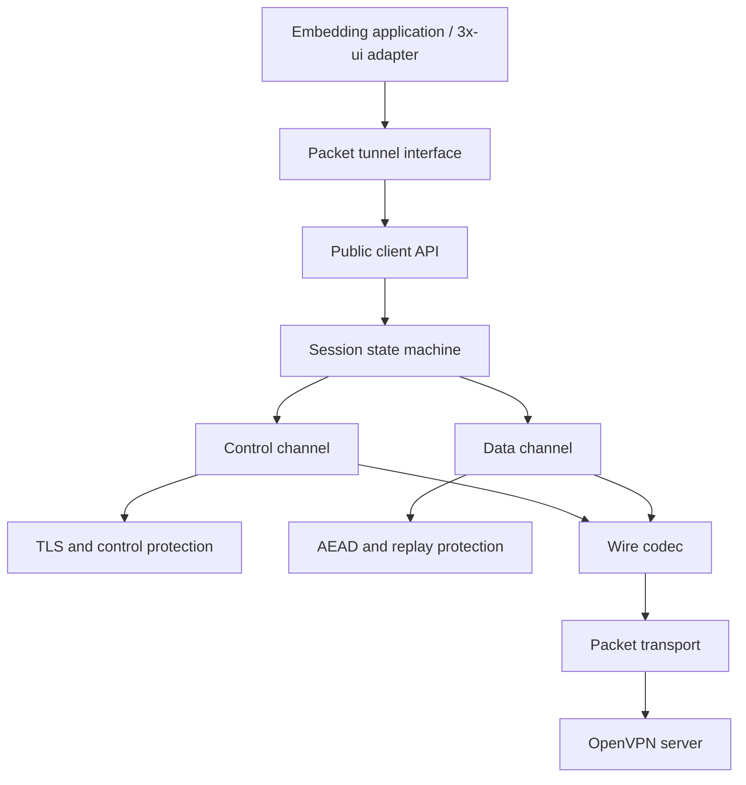

# Architecture

## Architectural style

Use a layered, ports-and-adapters design. The public API describes client behavior and packet boundaries. Internal packages implement protocol details. Platform-specific tunnel devices and application integrations remain adapters outside the protocol core.

## Package map

```text
openvpn-go/
  client/                 Public client lifecycle and configuration
  profile/                Public OVPN parser and validation
  transport/              Public packet transport contract; UDP/TCP adapters
  tunnel/                 Public packet I/O contract for the embedding app
  internal/
    wire/                 Packet headers, opcodes, TCP framing, codecs
    control/              Control packet reliability, ACK and replay windows
    tlscontrol/           TLS handshake, peer identity, tls-auth/crypt modes
    data/                  Data packet formats, AEAD and replay checks
    crypt/                  Key derivation and cipher adapters
    session/               Session state machine, keepalive and rekey
    failover/              Endpoint ordering, retry and backoff policy
    observability/         Redacted events, counters and timing
    testkit/               Fake transports and deterministic test fixtures
  cmd/ovpn-inspect/        Diagnostic profile/packet inspection CLI
  integrations/xray/       Optional adapter; never imported by core packages
  tests/interop/           Real OpenVPN server/client interoperability tests
  tests/fuzz/              Fuzz targets for untrusted input
  docs/                    Specifications, ADRs, security and roadmap
```

## Dependency direction

- client may depend on profile, transport, tunnel and internal packages.
- profile may depend on standard library parsing/validation helpers only.
- transport defines the packet transport port; concrete UDP/TCP adapters implement it.
- tunnel defines the packet source/sink supplied by the caller.
- internal packages may depend on one another according to the protocol flow, but must not import integrations.
- integrations/xray depends on the public API only.
- no import cycle; no dependency from protocol core to 3x-ui/Xray.

## Core boundaries

### Transport boundary

The protocol engine consumes and emits complete OpenVPN packets. UDP maps one transport datagram to one protocol packet. TCP performs OpenVPN's 16-bit network-byte-order length framing and exposes the same packet abstraction to the protocol engine. Custom dialers/proxies implement the same contract.

### Tunnel boundary

The protocol engine moves IP packets, not Ethernet frames. The embedding application supplies a packet source/sink. A platform TUN device or an Xray adapter is a separate integration concern. The core must not open privileged devices or mutate routes.

### Session boundary

A session owns:
- one selected remote endpoint;
- one transport instance;
- one TLS control channel;
- control-channel reliability state;
- negotiated data-channel keys and key generations;
- replay windows and packet counters;
- timers and cancellation context.

The session state machine must make transitions explicit and reject invalid transitions.

### Cryptographic boundary

Use standard or established cryptographic primitives. Implement protocol-specific framing, key derivation and nonce construction from the published protocol rules, but do not invent or hand-roll primitives. Separate TLS identity verification from optional control-channel packet protection and data-channel AEAD.

## Data flow



## Lifecycle

1. Parse and validate the profile.
2. Resolve endpoint order and transport policy.
3. Dial one endpoint with bounded timeout.
4. Establish TLS and authenticate the server identity.
5. Complete OpenVPN control negotiation and authenticate the client.
6. Derive data-channel keys and initialize replay/key-generation state.
7. Exchange IP packets through the packet API.
8. Maintain keepalive, control reliability and rekey.
9. On recoverable failure, close the failed transport and try the next endpoint under the configured policy.
10. On cancellation or Close, stop timers, unblock I/O and release all resources.

## M1 public API

| Entry point | Contract |
|---|---|
| `client.New(Config)` | Validate and copy the endpoints, apply packet and timeout defaults, and prepare an idle client without network I/O. |
| `Client.Connect(ctx)` | Dial the first configured endpoint with a separate dial deadline, then pass the owned transport to the internal handshake with its own deadline. On success the authenticated session owns that transport. A failed attempt closes the transport and permits another call. |
| `Client.State()`, `Client.ActiveEndpoint()` and `Client.ControlInfo()` | Concurrent-safe snapshots. Only an authenticated session publishes the active endpoint and its negotiated settings. |
| `Client.Run(ctx, tunnel.PacketConn)` | Start one bidirectional forwarding run on an authenticated session. Two bounded packet buffers support one worker per direction. Join both workers on exit and release the session. The embedding application owns its tunnel and may reuse it after the call. |
| `Client.Close()` | Cancel in-flight dial, handshake and forwarding, release the owned session, join operations and permanently close the client. Concurrent Close calls share one result. |
| `client.Error` | Return a redacted operation and error code. Use `errors.As` to inspect the code and `errors.Is` for canceled, timed-out or closed operations. |
| `transport.SocketDialer` | Provide native UDP datagrams or TCP length-framed packets. Both use a 16 KiB default limit. An oversized TCP input closes the stream. UDP drops the offending datagram and preserves the next boundary. |

Callers may inject a cancellable `transport.Dialer`. The transport and
tunnel ports permit concurrent reading and writing, retain no caller buffer,
and discard a packet when the destination is too short. Cancellation before
any TCP frame bytes are read or written leaves the stream usable. An
interrupted partial frame closes it.

## M2 control session

The reliable control driver validates a server reset before exposing ordered
bytes to TLS. It keeps ACK, retransmit and wrapper replay state separate and
bounds all retained messages. The optional outer protection covers the reset
and the later TLS records. With tls-crypt-v2, only an authenticated initial
server response can request an additional copy of the opaque wrapped key.

The control exchange progresses through reset, verified TLS, key method 2
and a complete authenticated `PUSH_REPLY`. The server selects an approved
cipher and peer ID and enables the TLS exporter. The session owns the
transport and its control workers.
[Protocol baseline](PROTOCOL_BASELINE.md) · [M2 evidence](MILESTONES.md#m2--control-channel-and-tls)

## M3 data session

`Connect` derives directional AEAD keys from the control TLS exporter.
The packet multiplexer dispatches `P_DATA_V2` and control records from one
transport reader. `Run` delivers authenticated IP packets to the tunnel,
with separate replay state for each data generation. It consumes encrypted
keepalives inside the session. The embedding application configures the
tunnel interface and routes.

A soft reset negotiates a verified TLS replacement. The previous control
stream stops when the replacement starts. The session sends with the current
data key until the replacement completes its reliable control flight, then
publishes the new key and retains the prior receive key for up to 30 seconds.
The key ID sequence advances from 0 through 7 and wraps to 1. Key use is
bounded before packet-ID exhaustion. M4 adds profile parsing and M5 adds
endpoint selection.
[Data channel](../internal/data/channel.go) · [Rekey lifecycle](../internal/session/rekey.go)

## Design constraints

- Avoid a monolithic client.go implementation.
- Avoid exposing internal wire structs as public API.
- Avoid callback APIs that can deadlock session goroutines.
- Avoid shared mutable TLS configs across endpoints; clone endpoint-specific configuration.
- Bound every queue and packet buffer.
- Make ownership and Close semantics explicit.
