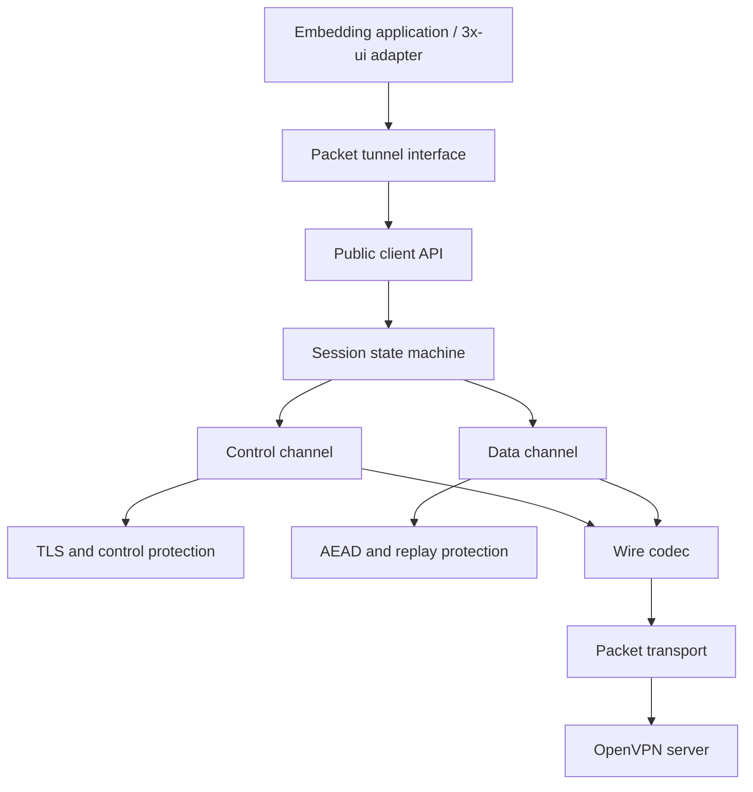

# Architecture

## Architectural style

Use a layered, ports-and-adapters design. The public API describes client behavior and packet boundaries. Internal packages implement protocol details. Platform-specific tunnel devices and application integrations remain adapters outside the protocol core.

## Package map

```text
openvpn-go/
  client/                 Public client lifecycle and configuration
  profile/                Public OVPN parser and validation
  transport/              Public packet transport contract; UDP/TCP adapters
  tunnel/                 Public packet I/O contract for the embedding app
  internal/
    wire/                 Packet headers, opcodes, TCP framing, codecs
    control/              Control packet reliability, ACK and replay windows
    tlscontrol/           TLS handshake, peer identity, tls-auth/crypt modes
    data/                  Data packet formats, AEAD and replay checks
    crypt/                  Key derivation and cipher adapters
    session/               Session state machine, keepalive and rekey
    failover/              Endpoint ordering, retry and backoff policy
    observability/         Redacted events, counters and timing
    testkit/               Fake transports and deterministic test fixtures
  cmd/ovpn-inspect/        Diagnostic profile/packet inspection CLI
  integrations/xray/       Optional adapter; never imported by core packages
  tests/interop/           Real OpenVPN server/client interoperability tests
  tests/fuzz/              Fuzz targets for untrusted input
  docs/                    Specifications, ADRs, security and roadmap
```

## Dependency direction

- client may depend on profile, transport, tunnel and internal packages.
- profile may depend on standard library parsing/validation helpers only.
- transport defines the packet transport port; concrete UDP/TCP adapters implement it.
- tunnel defines the packet source/sink supplied by the caller.
- internal packages may depend on one another according to the protocol flow, but must not import integrations.
- integrations/xray depends on the public API only.
- no import cycle; no dependency from protocol core to 3x-ui/Xray.

## Core boundaries

### Transport boundary

The protocol engine consumes and emits complete OpenVPN packets. UDP maps one transport datagram to one protocol packet. TCP performs OpenVPN's 16-bit network-byte-order length framing and exposes the same packet abstraction to the protocol engine. Custom dialers/proxies implement the same contract.

### Tunnel boundary

The protocol engine moves IP packets, not Ethernet frames. The embedding application supplies a packet source/sink. A platform TUN device or an Xray adapter is a separate integration concern. The core must not open privileged devices or mutate routes.

### Session boundary

A session owns:
- one selected remote endpoint;
- one transport instance;
- one TLS control channel;
- control-channel reliability state;
- negotiated data-channel keys and key generations;
- replay windows and packet counters;
- timers and cancellation context.

The session state machine must make transitions explicit and reject invalid transitions.

### Cryptographic boundary

Use standard or established cryptographic primitives. Implement protocol-specific framing, key derivation and nonce construction from the published protocol rules, but do not invent or hand-roll primitives. Separate TLS identity verification from optional control-channel packet protection and data-channel AEAD.

## Data flow



## Lifecycle

1. Parse and validate the profile.
2. Resolve endpoint order and transport policy.
3. Dial one endpoint with bounded timeout.
4. Establish TLS and authenticate the server identity.
5. Complete OpenVPN control negotiation and authenticate the client.
6. Derive data-channel keys and initialize replay/key-generation state.
7. Exchange IP packets through the packet API.
8. Maintain keepalive, control reliability and rekey.
9. On recoverable failure, close the failed transport and try the next endpoint under the configured policy.
10. On cancellation or Close, stop timers, unblock I/O and release all resources.

## API shape (not frozen)

The public API is expected to expose:
- Config and validated Profile types.
- Client construction and Connect/Close lifecycle.
- packet read/write methods or a Run method bound to a PacketTunnel.
- context-aware cancellation.
- ActiveEndpoint, State and Stats snapshots.
- typed errors that distinguish retryable network failures from terminal authentication and certificate failures.

Do not freeze signatures until M1 API review and an Xray integration spike.

## Design constraints

- Avoid a monolithic client.go implementation.
- Avoid exposing internal wire structs as public API.
- Avoid callback APIs that can deadlock session goroutines.
- Avoid shared mutable TLS configs across endpoints; clone endpoint-specific configuration.
- Bound every queue and packet buffer.
- Make ownership and Close semantics explicit.
